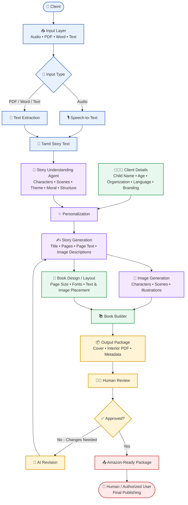
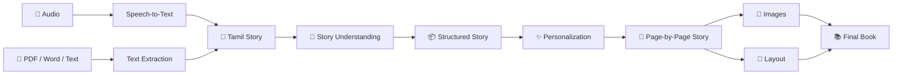
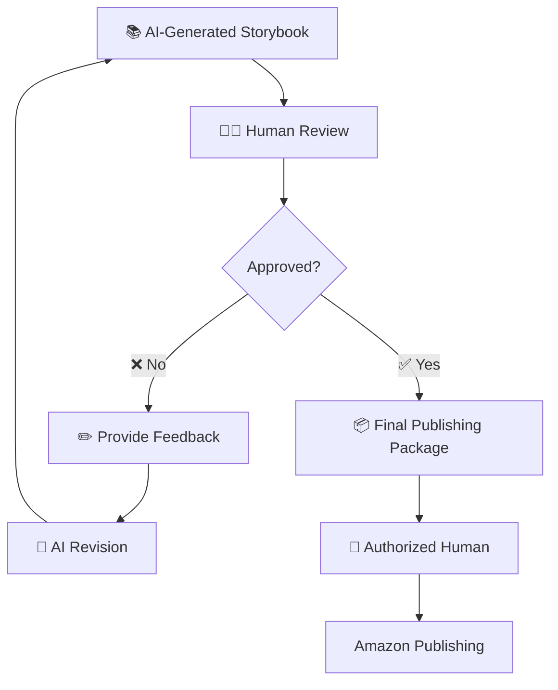
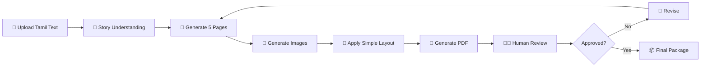

# Tamil Story → Digital Storybook → Amazon
## High-Level Architecture

> **Goal:** Convert a Tamil story provided as audio or a document into a personalized digital storybook, with AI-assisted generation and mandatory human approval before the final publishing package is prepared.

---

## 1. Overall Architecture



---

## 2. Main Components

| Component | Purpose |
|---|---|
| **Input Layer** | Accept audio, PDF, Word, or text story |
| **Speech-to-Text** | Convert Tamil audio into text |
| **Text Extraction** | Extract text from PDF/Word files |
| **Story Understanding Agent** | Understand characters, scenes, theme, moral, and story structure |
| **Personalization** | Apply child, client, organization, language, and branding details |
| **Story Generation** | Create title, pages, page text, and image descriptions |
| **Image Generation** | Generate illustrations for the story pages |
| **Book Design / Layout** | Decide page size, fonts, spacing, image placement, and visual style |
| **Book Builder** | Combine cover, pages, images, and metadata into final files |
| **Human Review** | Allow a person to inspect and request changes |
| **Amazon-Ready Package** | Prepare the approved book files and metadata for publishing |

---

## 3. Client Input Screen

```text
┌──────────────────────────────────────────────────────┐
│              📚 CREATE A TAMIL STORYBOOK             │
├──────────────────────────────────────────────────────┤
│                                                      │
│  STEP 1 — Upload Your Story                          │
│                                                      │
│  ┌────────────────────────────────────────────────┐  │
│  │                                                │  │
│  │       🎤  Upload Audio                        │  │
│  │                                                │  │
│  │       📄  Upload PDF / Word / Text             │  │
│  │                                                │  │
│  └────────────────────────────────────────────────┘  │
│                                                      │
│  STEP 2 — Story Details                               │
│                                                      │
│  Language:       [ Tamil ▼ ]                         │
│                                                      │
│  Child Name:     [ Arjun                         ]   │
│                                                      │
│  Age:            [ 7                             ]   │
│                                                      │
│  Organization:   [ ABC Learning                  ]   │
│                                                      │
│  Book Style:     [ Children's Storybook ▼        ]   │
│                                                      │
│                     [ ✨ CREATE STORYBOOK ]           │
│                                                      │
└──────────────────────────────────────────────────────┘
```

---

## 4. Story Processing Flow



---

## 5. Human-in-the-Loop



---

## 6. Final Output

The system can produce a package such as:

```text
storybook/
│
├── cover.jpg
├── interior.pdf
├── metadata.json
│
└── assets/
    ├── page_01.png
    ├── page_02.png
    ├── page_03.png
    └── ...
```

### Example metadata

```json
{
  "title": "Arjun and the Brave Little Rabbit",
  "language": "Tamil",
  "age_range": "6-8",
  "organization": "ABC Learning",
  "description": "A children's story about courage and kindness.",
  "keywords": [
    "Tamil children's story",
    "rabbit story",
    "kids story"
  ]
}
```

---

## 7. Recommended MVP

For the first prototype, keep the scope small:



After the MVP works, add:

1. Audio input and speech-to-text
2. PDF/Word input
3. Client personalization
4. Character consistency
5. Brand customization
6. Database and versioning
7. Advanced book layouts
8. Amazon publishing workflow

---

## 8. Suggested Technology Categories

| Area | Possible Technology |
|---|---|
| Frontend | React / Next.js |
| Backend | Python / FastAPI |
| LLM | OpenAI / Anthropic / Gemini / Groq |
| Speech-to-Text | Whisper or similar |
| Document Processing | PDF/Word parsers |
| Image Generation | Image generation API |
| Database | PostgreSQL |
| File Storage | S3-compatible storage |
| AI Workflow | LangGraph or custom Python workflow |
| PDF Generation | ReportLab / HTML-to-PDF / document rendering |
| Authentication | OAuth / application authentication |
| Human Review | Web dashboard |
| Publishing | Amazon publishing workflow/API where supported |

> **Note:** The exact technology choices should be decided after checking the consultancy's existing infrastructure, budget, security requirements, and preferred cloud/provider.

---

## 9. One-Line Architecture

**Input → Extract → Understand → Personalize → Generate → Illustrate → Layout → Build → Human Review → Approve → Publishing Package**

