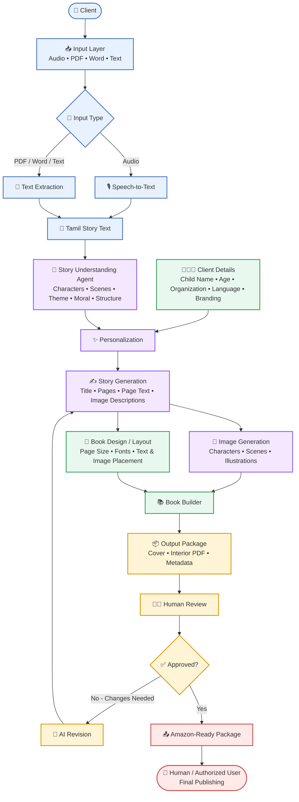
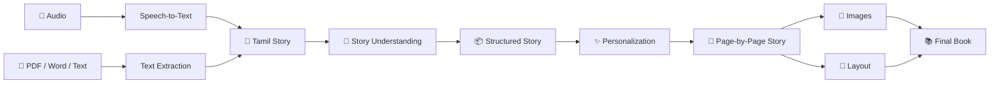
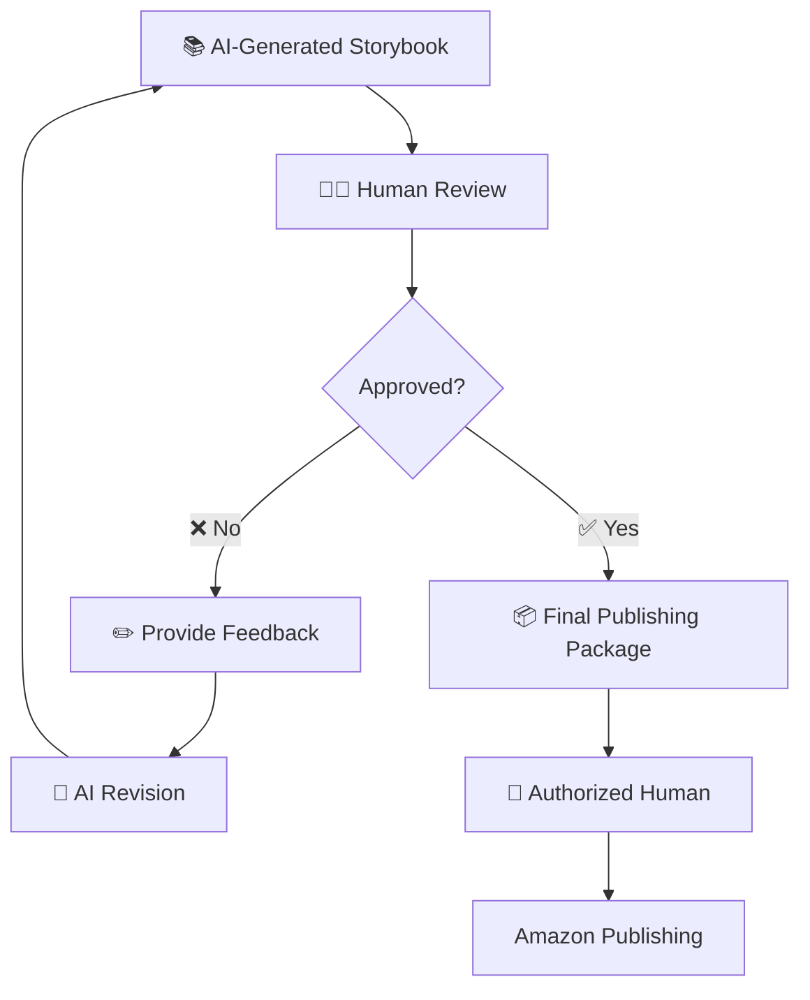
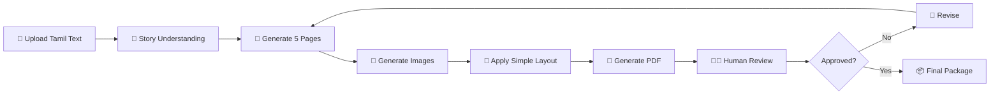

# Tamil Story → Digital Storybook → Amazon
## High-Level Architecture

> **Goal:** Convert a Tamil story provided as audio or a document into a personalized digital storybook, with AI-assisted generation and mandatory human approval before the final publishing package is prepared.

---

## 1. Overall Architecture



---

## 2. Main Components

| Component | Purpose |
|---|---|
| **Input Layer** | Accept audio, PDF, Word, or text story |
| **Speech-to-Text** | Convert Tamil audio into text |
| **Text Extraction** | Extract text from PDF/Word files |
| **AI Workflow (LangChain + Python)** | Connect LLM prompts and model calls; use Python functions to coordinate the end-to-end workflow |
| **Story Understanding Agent** | Understand characters, scenes, theme, moral, and story structure |
| **Personalization** | Apply child, client, organization, language, and branding details |
| **Story Generation** | Create title, pages, page text, and image descriptions |
| **Image Generation** | Generate illustrations for the story pages |
| **Book Design / Layout** | Decide page size, fonts, spacing, image placement, and visual style |
| **Book Builder** | Combine cover, pages, images, and metadata into final files |
| **Human Review** | Allow a person to inspect and request changes |
| **Amazon-Ready Package** | Prepare the approved book files and metadata for publishing |

---

### AI Workflow Approach: LangChain + Custom Python

For the MVP, use **LangChain with custom Python functions** rather than LangGraph.

- **LangChain** helps connect an LLM to prompts, structured outputs, and tools. In this project, it can help analyze the story, identify characters and scenes, and draft page text and image descriptions.
- **Custom Python** coordinates the application steps, such as extracting text, calling the image-generation service, saving files, building the PDF, and sending the result to human review.
- **LangGraph is not required for the initial MVP.** It can be reconsidered later if the workflow needs complex branching, persistent state, or long-running review-and-revision loops.

A simple implementation could use functions such as `extract_story()`, `analyze_story_with_langchain()`, `create_page_prompts()`, `generate_illustrations()`, `build_pdf()`, and `submit_for_review()`. These are example function names, not existing code requirements.

## 3. Client Input Screen

```text
┌──────────────────────────────────────────────────────┐
│              📚 CREATE A TAMIL STORYBOOK             │
├──────────────────────────────────────────────────────┤
│                                                      │
│  STEP 1 — Upload Your Story                          │
│                                                      │
│  ┌────────────────────────────────────────────────┐  │
│  │                                                │  │
│  │       🎤  Upload Audio                        │  │
│  │                                                │  │
│  │       📄  Upload PDF / Word / Text             │  │
│  │                                                │  │
│  └────────────────────────────────────────────────┘  │
│                                                      │
│  STEP 2 — Story Details                               │
│                                                      │
│  Language:       [ Tamil ▼ ]                         │
│                                                      │
│  Child Name:     [ Arjun                         ]   │
│                                                      │
│  Age:            [ 7                             ]   │
│                                                      │
│  Organization:   [ ABC Learning                  ]   │
│                                                      │
│  Book Style:     [ Children's Storybook ▼        ]   │
│                                                      │
│                     [ ✨ CREATE STORYBOOK ]           │
│                                                      │
└──────────────────────────────────────────────────────┘
```

---

## 4. Story Processing Flow



---

## 5. Human-in-the-Loop



---

## 6. Final Output

The system can produce a package such as:

```text
storybook/
│
├── cover.jpg
├── interior.pdf
├── metadata.json
│
└── assets/
    ├── page_01.png
    ├── page_02.png
    ├── page_03.png
    └── ...
```

### Example metadata

```json
{
  "title": "Arjun and the Brave Little Rabbit",
  "language": "Tamil",
  "age_range": "6-8",
  "organization": "ABC Learning",
  "description": "A children's story about courage and kindness.",
  "keywords": [
    "Tamil children's story",
    "rabbit story",
    "kids story"
  ]
}
```

---

## 7. Recommended MVP

For the first prototype, keep the scope small:



After the MVP works, add the following capabilities in stages. These are planned enhancements, not requirements for the first prototype.

### 7.1 Audio Input and Speech-to-Text

**What it means:** Allow a client to upload or record a spoken Tamil story instead of typing it. A speech-to-text (STT) service converts the recording into written text that the story pipeline can process.

**How it works:**
1. The client uploads an audio file or records a story in the browser.
2. The application checks the file type, duration, and size.
3. The STT service transcribes the speech into Tamil text.
4. The client reviews and corrects names, places, and words that were transcribed incorrectly.
5. The approved transcript is sent to the existing story-understanding step.

**Example:** A grandparent tells a traditional Tamil story aloud. The application creates a draft transcript that can be corrected before the storybook is generated.

**Important considerations:** Tamil language and dialect support, background noise, speaker accents, privacy of recordings, and a way to replay audio and edit the transcript. Speech-to-text can make mistakes, so human review is important.

**Possible acceptance criteria:** A supported audio file can be uploaded, a transcript is produced, the client can edit it, and only the confirmed transcript is used to create the book.

### 7.2 PDF and Word Input

**What it means:** Let clients upload stories that are already written in PDF or Microsoft Word formats (`.pdf`, `.docx`, and, if required, `.doc`). The application extracts the text so clients do not have to copy and paste it manually.

**How it works:**
1. The client uploads a document.
2. The application validates the file type and size.
3. A document parser extracts the text and, where practical, headings and paragraph order.
4. The application displays the extracted text for review.
5. The approved text enters the same story-understanding pipeline as typed or transcribed text.

**Example:** A teacher uploads a Word document containing a Tamil story. The application extracts the story and prepares it for conversion into a picture book.

**Important considerations:** Scanned PDFs may require OCR (optical character recognition); complex tables, unusual fonts, images, and multi-column layouts may not extract perfectly. Password-protected or corrupted files should produce a clear error message. Uploaded files should be handled securely.

**Possible acceptance criteria:** Supported PDF and Word files can be uploaded, extracted text is shown to the client, extraction errors are explained, and the client can correct the text before continuing.

### 7.3 Client Personalization

**What it means:** Adapt a storybook to the intended child, family, classroom, or organization without losing the original story's meaning or important cultural details.

**Personalization fields may include:**
- Child's name and preferred form of address.
- Age range and reading level.
- Preferred language (for example, Tamil or English).
- Interests, such as animals, space, or nature.
- Desired length, tone, and learning goal.
- Optional setting or supporting-character details supplied by the client.

**How it works:** The client completes a form. The system passes the selected details to the story-generation step and checks that the resulting text is age-appropriate and consistent with the source story. The client can preview and approve changes.

**Example:** A story can address a child named Arjun and use simpler sentences for readers aged 6–8, while preserving the original story's lesson about kindness.

**Important considerations:** Collect only information needed for the book, protect children's personal information, and do not assume that personalization permits changing the story's cultural meaning. Make optional fields clearly optional.

**Possible acceptance criteria:** Personalization settings are applied consistently to the story, the client can preview the result, and the original source text remains available for comparison.

### 7.4 Character Consistency

**What it means:** Keep each illustrated character recognizable from page to page. The same character should retain key visual features, such as clothing, colors, hairstyle, age, and distinguishing details.

**How it works:**
1. The system creates a character description or character reference sheet.
2. The client or reviewer approves the reference.
3. Each page's image prompt refers to that approved character description and, where supported, reference images or a consistent image-generation workflow.
4. Generated illustrations are reviewed for visual differences.
5. Images that do not match can be regenerated or corrected.

**Example:** If the main character wears a blue shirt and has curly hair on page one, those features should remain recognizable on later pages unless the story explicitly changes them.

**Important considerations:** Image-generation systems may still change details between images. Character references, fixed descriptions, image editing, and human review can improve consistency but cannot guarantee perfect results.

**Possible acceptance criteria:** The project stores an approved description/reference for each recurring character, image prompts reuse it, and a reviewer can flag and replace inconsistent illustrations.

### 7.5 Brand Customization

**What it means:** Allow each client or organization to apply its own approved visual identity to the book and, if needed, the creation interface.

**Customizable elements may include:**
- Organization name and logo.
- Brand colors and approved fonts.
- Cover design and page templates.
- Copyright, acknowledgements, and optional dedication pages.
- Footer or imprint details where appropriate.

**How it works:** A client selects an existing brand profile or enters permitted settings. The book builder applies those settings to the cover and interior while keeping text readable and respecting print requirements.

**Example:** A school or nonprofit can generate a storybook using its approved logo and colors rather than manually redesigning every page.

**Important considerations:** Only use logos and assets the client is authorized to use. Maintain accessible contrast and readable font sizes. Brand styling should not override print specifications or make the book difficult to read.

**Possible acceptance criteria:** A saved brand profile can be selected for a project, and the generated cover and interior consistently use its approved settings.

### 7.6 Database and Versioning

**What it means:** Store project information safely and keep a history of important changes. This allows a client to return to a draft later, compare revisions, and recover an earlier approved version.

**Information that may be stored:**
- Project ID, client or organization reference, and timestamps.
- Original story text and confirmed transcript.
- Personalization and brand settings.
- Page text, character descriptions, image references, and layout settings.
- Review comments, approval status, and generated output locations.
- Version number and a record of what changed.

**How it works:** Each book project has a unique ID. When a meaningful edit is saved, the system creates a new version or revision record rather than silently replacing the previous approved version. Files such as audio, images, and PDFs may be kept in secure file storage, while the database stores their references and project metadata.

**Example:** Version 1 contains the first draft. A reviewer requests a change to page three, creating version 2. The team can compare both versions and return to version 1 if needed.

**Important considerations:** Set access permissions, protect personal data, back up important records, and define retention/deletion rules. Avoid storing large image or audio files directly in ordinary database fields when object/file storage is more appropriate. Database design and access controls require backend implementation.

**Possible acceptance criteria:** Projects can be reopened, revisions are identifiable, the approved version is preserved, and authorized users can view or restore an earlier version.

### 7.7 Advanced Book Layouts

**What it means:** Go beyond a simple fixed layout and support polished book designs for different reading and publishing needs.

**Potential features include:**
- Configurable trim size, portrait or landscape orientation, and page count.
- Full-page illustrations, text-and-image spreads, title pages, dedication pages, and end pages.
- Consistent margins, typography, spacing, page numbering, and headers/footers where appropriate.
- Cover design, including front cover, spine, and back cover when required.
- Layout checks for text overflow, low-resolution images, missing fonts, and content near trim edges.
- Export to PDF and potentially other formats if required by the publishing target.

**How it works:** The book builder applies a selected template to the approved page text and illustrations. It renders a preview so a reviewer can inspect every page before the final files are created.

**Example:** A short children's book could use one large illustration with a few lines of text per page, while a longer educational book could use a different template with headings and more text.

**Important considerations:** Print and ebook formats have different requirements. For print, page dimensions, bleed, margins, image resolution, fonts, and cover/spine measurements must match the chosen printer or platform's current specifications. A PDF that looks correct on screen is not automatically print-ready.

**Possible acceptance criteria:** The user can select a supported template, preview every page, receive warnings for common layout issues, and export a file that passes the project's defined validation checks.

### 7.8 Amazon Publishing Workflow

**What it means:** Prepare the approved storybook for a human to publish through Amazon Kindle Direct Publishing (KDP), if KDP is the selected publishing platform. This feature should first create and validate the required files and metadata; it should not assume that direct automated publishing is available.

**The workflow may include:**
1. Confirm the final title, subtitle, author/contributor details, description, language, keywords, categories, and other required metadata.
2. Generate the interior file and cover according to the selected format's current KDP requirements.
3. Check page dimensions, margins, bleed, image quality, fonts, and other relevant file requirements.
4. Display a final preview and a checklist of unresolved issues.
5. Package the validated files and metadata for the authorized person to upload through KDP.
6. Let the authorized person complete the platform's review, rights declarations, pricing, distribution, and publication steps.

**Example:** After a reviewer approves the storybook, the system prepares the interior PDF, cover file, and metadata checklist so the publisher can upload them to KDP and inspect the platform's previewer.

**Important considerations:** Requirements can differ for print books and Kindle ebooks and can change over time. Confirm current KDP specifications before implementation. The publisher remains responsible for copyright, permissions, truthful metadata, content compliance, pricing, and final submission. Do not promise automatic publication unless an officially supported integration and the required permissions have been confirmed.

**Possible acceptance criteria:** The system generates the selected format's required files, validates known technical requirements, provides a metadata checklist, and clearly identifies the human steps still required before publication.

### Suggested Implementation Order

A practical order after the MVP is:

1. **PDF/Word input** — expands the ways clients can provide stories.
2. **Client personalization** — adds useful customization to the existing text workflow.
3. **Database and versioning** — supports saving projects and managing revisions as usage grows.
4. **Character consistency** — improves the quality of recurring illustrations.
5. **Brand customization** — supports books for multiple clients or organizations.
6. **Audio input and speech-to-text** — adds recording and transcription, including transcript correction.
7. **Advanced book layouts** — improves design and print-ready validation.
8. **Amazon publishing workflow** — prepares files and metadata after the generation and review steps are reliable.

This order is a suggested roadmap, not a strict dependency. Priorities should be adjusted based on client needs, budget, available services, and publishing goals. Keep human review and approval in the workflow throughout all stages.

---

## 8. Suggested Technology Categories

| Area | Possible Technology |
|---|---|
| Frontend | React / Next.js |
| Backend | Python / FastAPI |
| LLM | OpenAI / Anthropic / Gemini / Groq |
| Speech-to-Text | Whisper or similar |
| Document Processing | PDF/Word parsers |
| Image Generation | Image generation API |
| Database | PostgreSQL |
| File Storage | S3-compatible storage |
| AI Workflow | **LangChain + custom Python workflow** for the MVP; consider LangGraph later only if workflow complexity requires it |
| PDF Generation | **HTML/CSS-to-PDF** for flexible visual layouts, or **ReportLab** for Python-driven PDF generation |
| Authentication | Application authentication; OAuth 2.0 with OpenID Connect (OIDC) if using a supported third-party sign-in provider |
| Human Review | Web dashboard for previewing pages, editing story text, regenerating images, approving/rejecting pages, and exporting the final PDF |
| Publishing | Prepare and validate files for Amazon KDP; use API integration only if an officially supported interface is confirmed |

### How These Components Work Together

1. **LangChain + Python workflow:** Processes the story and coordinates the AI-assisted generation steps.
2. **PDF generation:** Combines approved story text and illustrations into a formatted storybook file. Use fonts and a renderer that correctly support Tamil text shaping.
3. **Authentication:** Controls who can sign in and access projects. Authentication identifies a user; authorization controls which projects and actions that user may access. A private team prototype may defer full sign-in, but a client-facing system needs appropriate access controls.
4. **Human review dashboard:** Lets a reviewer inspect every page, edit text, request image regeneration, add notes, and approve the final storybook. Human approval remains a required checkpoint.
5. **Publishing workflow:** Prepares the interior file, cover, and metadata for the intended publishing format. Do not assume KDP supports fully automated upload or publication; verify current platform requirements and keep a human responsible for final submission unless an officially supported integration is confirmed.

> **Note:** These are proposed technology choices. Confirm the team's existing infrastructure, budget, security requirements, and preferred providers before implementation.

---

## 9. One-Line Architecture

**Input → Extract → Understand → Personalize → Generate → Illustrate → Layout → Build → Human Review → Approve → Publishing Package**

